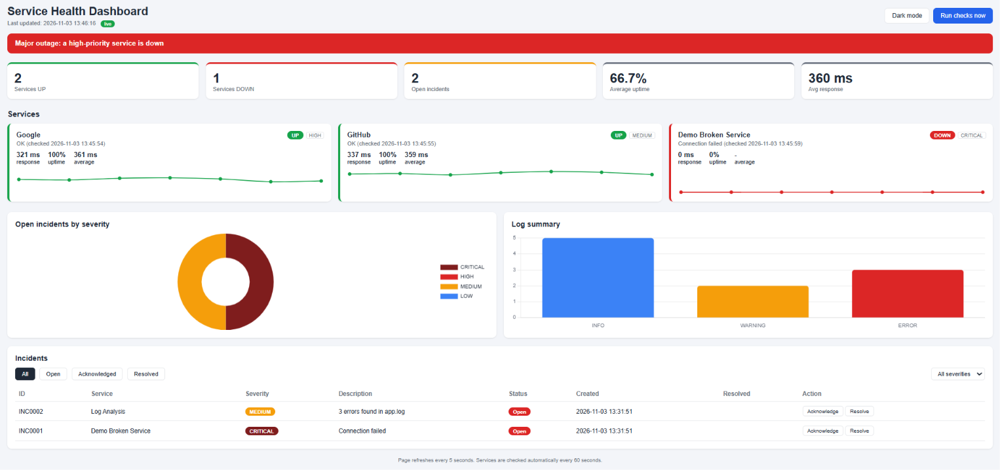

# Service Health Monitor and Incident Tracker

Python and Flask tool that monitors services, detects failures, creates incident tickets automatically and shows everything on a live web dashboard.



## Overview

This project simulates how an operations / technical support team monitors systems. It checks whether services are UP or DOWN, scans application logs for errors, raises incidents with a severity level, and tracks each incident from Open to Acknowledged to Resolved.

One outage creates one ticket. When a service recovers, its incident is resolved automatically.

## Features

- Health checks for websites and APIs (status and response time)
- Automatic incident creation with ID (INC0001), severity and status
- No duplicate tickets for the same outage
- Escalation message for HIGH and CRITICAL incidents
- Log analysis (INFO / WARNING / ERROR) that raises an incident when errors pass a threshold
- Live web dashboard with auto-refresh, uptime %, response-time charts and incident filters
- Incident workflow in the browser: Acknowledge and Resolve buttons
- Light and dark mode
- SQLite database, plus JSON and CSV reports (CSV can be opened in Power BI or Excel)
- Command-line version that also generates a static HTML dashboard

## Core Components

| Part | Technology |
|---|---|
| Monitoring and logic | Python, requests |
| Web server and API | Flask (REST endpoints returning JSON) |
| Database | SQLite (SQL: INSERT, SELECT, UPDATE) |
| Frontend | HTML, CSS, JavaScript |
| Charts | Chart.js |
| Configuration | JSON (`services.json`) |

## How It Works

1. `app.py` starts a background scheduler that runs all checks every 60 seconds
2. `monitor.py` checks each service and the log file
3. Failures create incidents in the SQLite database (`database.py`)
4. The browser calls `/api/summary` every 5 seconds and updates the page
5. Buttons on the page call the API to acknowledge or resolve incidents

## Project Structure

| File | Purpose |
|---|---|
| `app.py` | Flask app, REST API and check scheduler |
| `monitor.py` | Check logic and command-line version |
| `database.py` | SQLite functions |
| `log_analyzer.py` | Log scanning |
| `dashboard.py` | Static HTML dashboard generator |
| `templates/dashboard.html` | Live dashboard page |
| `static/style.css` | Styling, light and dark themes |
| `static/dashboard.js` | Fetches data, draws charts, handles buttons |
| `services.json` | Services to monitor |
| `app.log` | Sample log file |

## How to Run

1. Install Python 3
2. Install the libraries:
   ```
   python -m pip install -r requirements.txt
   ```
3. Start the live dashboard:
   ```
   python app.py
   ```
4. Open http://127.0.0.1:5000 in your browser (press Ctrl+C to stop)

Command-line version (runs once and exits):
```
python monitor.py
python monitor.py incidents
```

## Add Your Own Service

Edit `services.json`:
```json
{"name": "My API", "url": "https://example.com/health", "severity": "HIGH"}
```
Severity options: LOW, MEDIUM, HIGH, CRITICAL.

## API Endpoints

| Method | URL | Purpose |
|---|---|---|
| GET | `/api/summary` | All dashboard data as JSON |
| POST | `/api/run-checks` | Run all checks now |
| POST | `/api/incidents/<id>/acknowledge` | Open to Acknowledged |
| POST | `/api/incidents/<id>/resolve` | Mark as Resolved |

## Runbook: What To Do When a Service Is DOWN

1. Confirm: run the checks again to rule out a temporary glitch
2. Check the incident ID, severity and error detail (Timeout, Connection failed, HTTP 500)
3. Acknowledge the incident so others know it is being handled
4. Escalate HIGH and CRITICAL incidents to the on-call team
5. Fix or restart the service following its procedure
6. Verify: the incident resolves automatically once the service is UP
7. Document the cause and the fix

## Severity Guide

| Severity | Meaning | Action |
|---|---|---|
| CRITICAL | Core service down | Escalate immediately |
| HIGH | Major feature affected | Escalate quickly |
| MEDIUM | Partial or minor issue | Fix during working hours |
| LOW | Minor issue | Plan a fix |

## Limitations and Future Improvements

- Runs locally with Flask's development server; there is no login on the dashboard
- Possible next steps: authentication, email alerts, deployment on AWS, Power BI dashboard on `incidents.csv`

## Author

Pamuditha (Sparrow) - HND in Software Engineering, NIBM
GitHub: https://github.com/achirapamuditha
